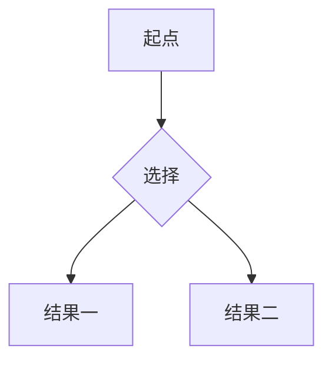

# 墨读 · Markdown 阅读器

为本地 Markdown 留一处安静的阅读空间。适用于桌面 Chrome 和 Microsoft Edge，采用 Manifest V3，中文界面。

## 安装

已经构建好的扩展在 **`dist`** 文件夹，直接加载即可，无须安装开发依赖。

1. Chrome 打开 `chrome://extensions`，或 Edge 打开 `edge://extensions`。
2. 开启右上角的「开发者模式」。
3. 点击「加载已解压的扩展程序」，选择本项目的 **`dist` 文件夹**。
4. 在扩展菜单中固定「墨读」，点击图标打开阅读器。

`release/inkstone-markdown-reader-v1.1.0.zip` 是当前版本的分发包。先解压，再通过上述方式加载解压后的文件夹。不要删除已加载的扩展文件夹；重新构建后，在扩展管理页点击刷新，再刷新已经打开的阅读器标签页。

## 功能

- **打开文档**：支持单选、多选与拖放 `.md` / `.markdown` / `.mdown` 文件，扩展名不区分大小写。
- **直接打开文件**：把 .md 关联到浏览器并开启「允许访问文件网址」后，双击文件即在墨读里完整打开——侧栏、批注、收藏、同步与最近阅读一样不少；文件地址后加 `?plain` 可切换为只读的纯阅读模式。
- **移除记录**：资料库的每一行与文件夹分组都可一键从资料库移除，连同批注与最近阅读记录一并清理；只删扩展内的记录，磁盘上的文件不受影响。
- **完整阅读**：标题、列表、任务列表、表格、引用、链接、图片、代码块与常用语言语法着色；目录导航与专注模式。
- **Mermaid 图表**：离线绘制中文流程图、时序图等，支持缩放、适应宽度和查看源码，随浅色 / 深色背景切换。
- **阅读样式**：4 种背景预设、自定义背景颜色、系统字体 / 中文宋体 / 衬线字体 / 等宽字体、12–32 px 字号、10–20 px 目录字号、40%–100% 显示比例（相对阅读区宽度，100% 时正文约占 80%，两侧各留约 10% 空白）、1.3–2.6 倍行距。窄窗口会自动适配。
- **高亮与评论**：选中文字后使用浮动工具条，支持 4 种高亮颜色；批注列表可定位原文、添加或编辑评论、删除指定批注。支持跨粗体、跨段与重叠选区。
- **最近阅读**：仅保留最近 20 份文档，重复打开会移到首位；保存阅读位置，下次打开继续读。
- **文件夹管理**：授权一个文件夹后递归识别其中的 Markdown，可切换是否显示子文件夹文档，按文件名和路径搜索，重新扫描文件夹，保存多个文件夹。
- **快速收藏**：顶部星标收藏 / 取消收藏，左侧「我的收藏」一键打开。
- **跨浏览器同步**：指定一个本机文件夹后，资料库、收藏、最近阅读、高亮与评论、阅读设置在同设备的多个浏览器之间双向同步。
- **导出**：右上角更多菜单可导出当前文档批注，或下载 Markdown 副本。

## 使用说明

### Mermaid 图表

在 Markdown 中使用带 `mermaid` 语言标记的代码块：

~~~markdown

~~~

也兼容整份文件直接以 `flowchart TD` 等 Mermaid 声明开头，以及未标注语言、但内容为图表定义的代码块。文档同时包含标题和正文时，请把图表定义放进代码块。普通代码块仍按原有方式显示。

图表上方提供放大、缩小、适应宽度和查看源码按钮；超出阅读区域的图表可在图表内部滚动。语法错误会在图表区域提示并保留源码，其余文档和其他图表继续显示。图表使用随扩展打包的 Mermaid，不加载远程渲染脚本；单个定义限制为 50,000 字符、500 条边。

可直接打开 [中文流程图示例](examples/mermaid-flowchart.md) 验证。图表绘制与主题切换不会改变正文批注的文本锚点。

### 文件夹授权

浏览器不会因为打开了一个文件，就允许扩展读取它的同级文件。请使用「打开文件夹」显式选择所在目录，随后自动扫描并列出文档；目录中的 `.git` 不参与扫描。

文件系统句柄保存在 IndexedDB。浏览器可能在重启或权限过期后要求再次授权；墨读会显示重新连接按钮。已打开文档有本地副本，权限暂时不可用或原文件被移动时仍可阅读。文件夹中从未打开过的文档需要读取授权才能首次显示内容。重新读取原文件或重新扫描文件夹时不会修改原文件。

支持在已授权文件夹内访问相对 `.md` 链接和相对图片（PNG、JPEG、GIF、WebP、AVIF、BMP、SVG）。单独打开文件时，请再打开其所在文件夹以加载旁边的图片。HTTP(S) 图片由浏览器直接请求原地址。

### 直接打开文件（双击 .md 进入墨读）

除了在墨读页面里打开，还可以让浏览器直接打开本地 Markdown 文件：双击（或拖入、在地址栏输入 `file:///…`）会自动进入墨读的完整界面——侧栏、高亮批注、收藏、跨浏览器同步与最近阅读全部可用，文档自动记入最近阅读。分两步设置：

1. **系统默认应用**：Windows「设置 → 应用 → 按文件类型选择默认应用」，把 `.md`（及 `.markdown` / `.mdown`）关联到 Chrome 或 Edge。系统级文件关联由操作系统管理，扩展只能配合浏览器完成，无法自行注册。
2. **扩展权限**：浏览器「扩展 → 墨读 → 详情」，打开**允许访问文件网址**。未开启时，双击打开只会显示 Markdown 原文。

打开过程与特性：

- 文件内容由 file:// 页面原样交给墨读（标签页随即跳进 `chrome-extension://…` 阅读器），全程只读，不改动原文件；
- 按文件路径复用已有记录：重复双击同一文件只刷新内容，不产生重复条目；在资料库中重新授权后即可实时读取原文件；
- 想要地址栏保持真实 `file://` 路径的纯阅读模式，在文件地址后加 `?plain`（交接失败时也会自动回落到该模式）。纯阅读下阅读样式（背景、字体、字号、显示比例、行距）跟随墨读设置，经后台线程带入页面，改动后按 `F5` 生效；相对链接与相对图片按文件所在目录解析，Mermaid、代码高亮与表格一致，但不提供批注与收藏；
- 权限被收回时回落到浏览器原文显示，重新开启即可。

### 批注与数据

批注、收藏、文档副本、文件夹句柄和阅读设置保存在**当前浏览器配置的本地 IndexedDB**，刷新和正常关闭浏览器后保留。每条批注独立保存，读写使用事务，连续或并发高亮不会覆盖此前批注。

带原生句柄的文件与文件夹每次打开都**直接读取磁盘上的原文件**，墨读从不复制、改名或修改原文件；IndexedDB 中的正文只是浏览器内的离线缓存，权限失效或文件被移动时仍可继续阅读，重新授权后会立即读取原文件的最新内容。扩展页面的地址栏始终是 `chrome-extension://…`——这是浏览器安全模型的限制，任何网页或扩展都无法把地址栏显示成 `file://` 路径；作为补偿，标签页标题会显示「文件名 · 所在文件夹」。浏览器扩展也无法自行注册成操作系统的默认 Markdown 打开方式（系统级文件关联只能在操作系统里设置），但配合下文的「直接打开文件（双击 .md 进入墨读）」，双击文件即可直接进入完整阅读界面；在墨读页面内可以用 `⌘/Ctrl + O`、拖放或「打开文件夹」快速打开。资料库行和文件夹分组都提供移除按钮，移除只删除扩展内的记录（连同批注），磁盘上的文件不受影响。

原文变化后，会通过摘录与前后文尝试重新定位高亮；无法可靠定位时，批注仍保留在列表中，并提示原文已变动。文件被重命名后会作为新路径识别，原路径已保存的批注与副本继续保留。

数据默认保存在**当前浏览器配置的本地 IndexedDB**，不上传文档。卸载扩展、清理扩展存储或删除浏览器配置会删除本地数据；重要评论可以通过「导出当前文档批注」保存为 Markdown，也可以通过下文的共享文件夹随其他浏览器共用。

为保持界面响应，单个 Markdown 文件大小上限为 20 MB。浏览器不支持文件系统选择器时，会退回文件 / 文件夹导入模式；导入副本需重新选择才能更新。

### 跨浏览器同步

扩展安装目录是只读的，各浏览器也各自安装一份扩展，因此数据天然隔离。要在同一台设备的多个浏览器之间共用资料库，请在「阅读样式」里点「选择同步文件夹」，为每个浏览器各选一次同一个本机文件夹（例如 `D:\墨读共享\`）。之后墨读会把资料库、收藏、最近阅读、高亮与评论、阅读设置写成该文件夹中的 `inkstone-*.json`，启动时与每 3 秒轮询一次双向读写合并。

合并规则：文档、批注、文件夹逐条按最后修改时间取新，收藏和阅读进度各自按自己的时间戳比较，删除通过墓碑传播以免被对端复活，最近阅读取两端并集，设置按键取胜者。两端同时修改时结果是确定性的，不会来回覆盖。文件夹本身若是云同步目录（OneDrive、Syncthing 等），同步会顺带跨设备生效。

需要了解的边界：

- 每个浏览器要各自授权一次；授权被浏览器回收时状态会显示「需要重新授权」，点一下按钮即可恢复。
- 文件与文件夹的读取句柄无法跨浏览器携带，另一个浏览器首次阅读同步来的文件夹文档时，需要重新授权该文件夹一次（按名称复用同一套记录，不会重复建库）。
- 同步文件是明文 JSON，放在你选择的本地目录里；不选择同步文件夹时，一切行为与从前完全一致。

### 快捷键

| 快捷键 | 操作 |
| --- | --- |
| `⌘/Ctrl + O` | 打开文件 |
| `⌘/Ctrl + Shift + O` | 打开文件夹 |
| `/` | 搜索文档 |
| `Esc` | 退出专注模式、收起弹层 |

## 开发

需要 Node.js 22.12 或更高版本。所有运行时代码和依赖均打包到扩展内部，不依赖远程脚本或 CDN。图表库按需从扩展自身的 `dist/chunks/` 加载，安装和分发时需保留整个 `dist` 目录。

```sh
npm ci
npm run build
npm test
npx playwright install chromium
npm run test:browser
npm run package
```

如需普通网页预览，先构建，再运行 `npm run dev`，打开 `http://127.0.0.1:4173`。预览页面与扩展具有各自独立的本地存储。

### 验证范围

核心测试覆盖历史记录上限与去重、并发存储、重新扫描保留收藏、相对路径、批注定位和独立图表识别，以及同步写入时间戳与删除墓碑、记录 / 收藏 / 进度 / 最近阅读的合并规则、拉取远端数据与推送载荷剥除句柄、阅读样式设置的宽容整理。浏览器验收在隔离的 Chromium 中**加载真正的 MV3 扩展**，覆盖文件导入、多段高亮、评论编辑删除、刷新恢复、阅读样式、收藏、阅读位置、原生文件系统句柄、目录扫描、相对图片和链接、关闭重启恢复、HTML 清理、窄窗口、离线中文 Mermaid 流程图、图表缩放、主题切换、图后批注保留与错误恢复、共享文件夹的推送与拉取，以及 **双击 .md 交给墨读完整界面**（侧栏、批注、最近阅读与资料库记录）、`?plain` 纯阅读兜底（同一份阅读设置经后台生效、相对链接与图片保留、Mermaid 渲染与不横向溢出）和**从资料库移除文档与文件夹**（批注、历史与墓碑一并写入，磁盘文件不动）。

自动化使用浏览器原生 OPFS 文件系统句柄验证目录与文件操作；操作系统文件选择对话框及用户个人浏览器中的授权提示需要在本机安装后操作。浏览器截图保存在 `test-results/`。

### 源码

| 路径 | 内容 |
| --- | --- |
| `src/app.js` | 界面交互、文件与文件夹管理、阅读与批注流程 |
| `src/db.js` | IndexedDB、事务、20 条历史与句柄保存 |
| `src/sync.js` | 共享文件夹双向同步、合并规则与轮询推送 |
| `src/annotations.js` | 文本选区、锚点恢复与重叠高亮 |
| `src/render.js` | Markdown、HTML 清理与语法着色 |
| `src/diagrams.js` | Mermaid 渲染、主题、缩放与源码切换 |
| `src/reading-style.js` | 阅读样式设置的整理与 CSS 变量映射（两种模式共用） |
| `src/file-reader.js` | file:// 原文页的内容脚本：把文件交给墨读主界面，`?plain` 时渲染纯阅读 |
| `src/file-reader.css` | file:// 交接占位与纯阅读页的最小外壳布局 |
| `src/styles.css` | 阅读排版、主题和响应式布局 |
| `src/background.js` | 扩展图标打开 / 聚焦阅读器、取阅读样式、接收双击文件的交接 |
| `scripts/build.mjs` | 构建、生成图标、保留依赖许可证 |

## 参考文档

- [Chrome File System Access API](https://developer.chrome.com/docs/capabilities/web-apis/file-system-access)
- [Manifest V3 内容安全策略](https://developer.chrome.com/docs/extensions/reference/manifest/content-security-policy)
- [Marked](https://marked.js.org/)
- [DOMPurify](https://github.com/cure53/DOMPurify)
- [Mermaid API 与安全配置](https://mermaid.js.org/config/usage)

第三方运行依赖许可证随构建保留在 `dist/licenses/`。
